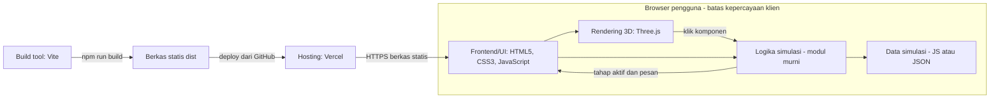
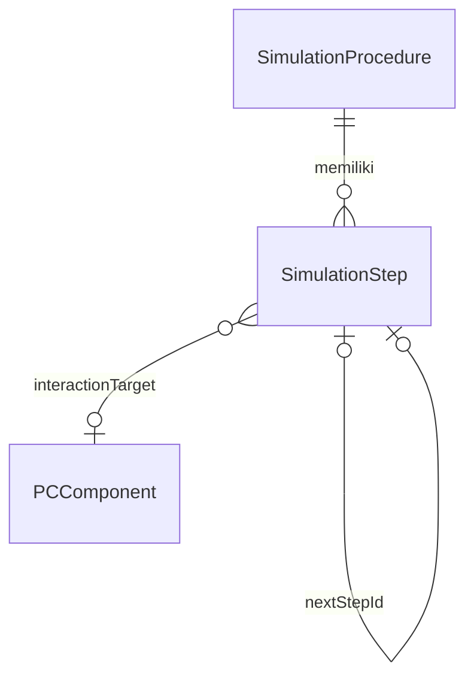

# Architecture: PC Power Simulator 3D

## Overview

PC Power Simulator 3D adalah aplikasi web statis sisi-klien: seluruh logika berjalan di browser pengguna dan tidak ada server sendiri. Frontend dibangun dengan HTML5, CSS3, dan JavaScript tanpa framework UI, sedangkan model komputer dirender oleh Three.js di elemen canvas. Vite dipakai sebagai server pengembangan dan alat build yang menghasilkan berkas statis di folder `dist/`, lalu Vercel melayani berkas itu lewat HTTPS. Data simulasi (tahapan, komponen, kuis) berupa berkas JavaScript atau JSON di dalam proyek. Logika tahapan sengaja dipisah dari kode Three.js dan DOM supaya dapat diuji otomatis dengan `node --test`.

## Tech Stack

| Lapisan | Pilihan | Alasan | Alternatif yang ditolak |
|---|---|---|---|
| Frontend/UI | HTML5, CSS3, dan JavaScript tanpa framework UI | (pilihan mahasiswa) Saya memilih Three.js sebagai teknologi utama karena proyek ini berfokus pada penerapan pemodelan dan simulasi 3D interaktif berbasis website. Untuk teknologi pendukung, saya mengutamakan stack yang sederhana, mudah dipelajari, ringan, dan realistis untuk diselesaikan dalam waktu pengerjaan yang tersedia. | - |
| Rendering 3D | Three.js (latest stable; verifikasi: `npm view three version`) | (pilihan mahasiswa) Teknologi utama proyek untuk model komputer dan simulasi interaktif; alasan lengkap pada baris Frontend/UI. | - |
| Build tool | Vite (latest stable; verifikasi: `npm view vite version`) | (pilihan mahasiswa) Menjalankan server pengembangan dan build produksi; alasan lengkap pada baris Frontend/UI. | - |
| Backend | Tidak ada | (pilihan mahasiswa) Tidak ada data pengguna dan tidak ada layanan yang perlu dipanggil, jadi tidak ada server yang dibutuhkan. | - |
| Database | Tidak ada; data simulasi berupa berkas JavaScript atau JSON di dalam proyek | (pilihan mahasiswa) Konten simulasi bersifat tetap dan tidak ada data yang ditulis pengguna. | - |
| Auth | Tidak ada | (pilihan mahasiswa) Tidak ada login atau registrasi; satu peran pengunjung. | - |
| Hosting | Vercel | (pilihan mahasiswa) Tempat deploy situs statis; URL hasil deploy adalah yang dikumpulkan. | - |
| Testing | Gabungan: `node --test` (otomatis, logika) dan uji manual di browser (3D, tampilan, responsivitas) | (pilihan mahasiswa) Logika tahapan dapat diuji tanpa browser; tampilan 3D diperiksa manual. | - |
| Lint | ESLint (latest stable; verifikasi: `npm view eslint version`) | Usulan asisten yang disetujui mahasiswa; alat lint standar ekosistem Node di kit. | - |

Bahasa pemrograman adalah JavaScript (bukan TypeScript), sehingga perintah typecheck dikosongkan. Kata kunci stack proyek: Three.js, JavaScript, Vite, HTML5, CSS3, Vercel.

## System Diagram



## Project Structure

```text
pc-power-simulator-3d/
├── AGENTS.md                 # panduan agen AI (singkat), sumber perintah proyek
├── README.md                 # pengantar dan cara menjalankan
├── SPEC.json                 # spesifikasi final dari wawancara
├── package.json              # skrip: dev, build, lint, test
├── package-lock.json         # dibuat di T-001, wajib di-commit (npm ci)
├── vite.config.js            # konfigurasi Vite
├── eslint.config.js          # konfigurasi ESLint (ikuti panduan resmi saat T-001)
├── index.html                # titik masuk Vite
├── .env.example              # daftar nama variabel lingkungan (saat ini kosong)
├── .gitignore                # memuat .env, node_modules, dist
├── public/                   # aset statis (favicon)
├── src/
│   ├── main.js               # merangkai modul saat halaman dimuat
│   ├── data/                 # data simulasi: tahapan, komponen, kuis
│   ├── logic/                # logika murni tanpa DOM dan Three.js (diuji node --test)
│   ├── scene/                # kode Three.js: scene, model dari geometri bawaan, interaksi
│   ├── ui/                   # kode DOM: panel petunjuk, penjelasan, peringatan, kuis
│   └── styles/               # CSS berdasarkan token di DESIGN_SYSTEM.md
├── tests/                    # berkas *.test.js untuk node --test
├── docs/                     # PRD, ARCHITECTURE, TASKS, dan dokumen lain
├── kit/                      # alat penyusun dokumen; bukan bagian aplikasi
└── .github/
    ├── workflows/ci.yml      # menjalankan perintah dari stack.commands
    └── pull_request_template.md
```

Struktur dasar mengikuti hasil perintah resmi `npm create vite@latest` dengan templat `vanilla` (cek perintah di dokumentasi Vite); folder `data`, `logic`, `scene`, `ui`, dan `tests` adalah penataan khusus proyek ini. T-001 memastikan struktur final dan mencatat perintah yang dipakai di `docs/PROGRESS.md`.

## Data Model

Data tersimpan sebagai berkas di `src/data/`, bukan database. Tidak ada field yang berisi data pribadi (`data.personal_data` = none).

**SimulationProcedure**

| Field | Tipe | Keterangan |
|---|---|---|
| id | string | Pengenal unik prosedur |
| title | string | Judul prosedur |
| description | string | Ringkasan prosedur |
| category | string | Kelompok prosedur (mis. menyalakan, mematikan) |
| steps | array | Daftar `SimulationStep` berurutan |

**SimulationStep**

| Field | Tipe | Keterangan |
|---|---|---|
| id | string | Pengenal unik tahap |
| order | number | Urutan tahap dalam prosedur |
| title | string | Judul tahap |
| phase | string | Salah satu fase: pemeriksaan perangkat, menyalakan, booting, masuk sistem operasi, shutdown |
| description | string | Penjelasan tujuan dan fungsi tahap (F4) |
| instruction | string | Petunjuk tindakan yang harus dilakukan (F3) |
| expectedAction | string | Tindakan yang memajukan tahap (F2) |
| warningMessage | string | Pesan peringatan bila tindakan salah (F5) |
| correction | string | Arahan memperbaiki tindakan (F5) |
| nextStepId | string atau null | Tahap berikutnya; null pada tahap terakhir |

**PCComponent**

| Field | Tipe | Keterangan |
|---|---|---|
| id | string | Pengenal unik komponen |
| name | string | Nama komponen yang tampil (F1) |
| description | string | Deskripsi singkat komponen |
| function | string | Fungsi komponen; diakses sebagai `komponen.function` |
| interactionTarget | string | Nama objek 3D yang dapat diklik |

**QuizQuestion** (dipakai F6)

| Field | Tipe | Keterangan |
|---|---|---|
| id | string | Pengenal unik soal |
| question | string | Teks pertanyaan |
| options | array | Pilihan jawaban |
| correctAnswer | string atau number | Penanda pilihan yang benar |
| explanation | string | Penjelasan setelah dijawab |



`QuizQuestion` berdiri sendiri dan tidak berelasi dengan entitas lain.

## Data Flow

**1. Memuat aplikasi (F1, F2).** Browser mengunduh berkas statis dari Vercel; `src/main.js` memuat data simulasi, membuat scene Three.js dengan model dari geometri bawaan, dan menyiapkan state tahap awal di memori. Tidak ada validasi masukan di tahap ini karena belum ada masukan pengguna.

**2. Tindakan pengguna pada simulasi (F2, F3, F5).** Pengguna mengeklik objek 3D atau tombol; modul `scene` menerjemahkan klik menjadi nama tindakan; modul `logic` membandingkannya dengan `expectedAction` tahap aktif. Bila sesuai, tahap maju ke `nextStepId`; bila tidak, tahap tetap sama (K2) dan `warningMessage` serta `correction` dikirim ke `ui` bila F5 sudah dibuat. Validasi hanya terjadi di modul `logic` sisi klien. Otorisasi tidak ada karena hanya ada satu peran.

**3. Melihat petunjuk atau penjelasan (F3, F4).** Pengguna memilih tahapan dari daftar; `ui` membaca `instruction` atau `description` tahapan itu dan menampilkannya tanpa mengubah tahap aktif (K3).

**4. Kuis (F6).** Pengguna menjawab soal dari `QuizQuestion`; `logic` menghitung skor di memori sesi dan `ui` menampilkannya. Skor dibuang saat halaman ditutup atau dimuat ulang (K4).

## External Services

| Layanan | Fungsi | Data yang dikirim | Batas/biaya gratis | Rencana cadangan |
|---|---|---|---|---|
| Vercel | Hosting situs statis dan URL yang dikumpulkan | Kode sumber dan hasil build; tidak ada data pengguna | Cek paket terbaru di vercel.com | Unggah isi `dist/` ke host statis lain bila Vercel bermasalah |
| GitHub | Penyimpanan kode, sumber deploy Vercel, dan menjalankan CI | Kode sumber proyek | Cek paket terbaru di github.com | Simpan salinan kode di lokal dan unggah ulang |
| npm registry | Sumber paket saat `npm ci` | Tidak ada data pengguna | Gratis untuk paket publik; cek paket terbaru | Gunakan `package-lock.json` dan cache npm lokal |

Tidak ada layanan pihak ketiga yang dipanggil dari browser pengguna.

## Environments and Configuration

| Lingkungan | Cara menjalankan | Perbedaan |
|---|---|---|
| Lokal | `npm run dev` (server pengembangan Vite) | Hot reload; dipakai untuk pengembangan dan uji manual |
| Preview | Deploy pratinjau dari Vercel untuk cabang selain main (verifikasi di dasbor Vercel) | Dipakai untuk memeriksa URL sebelum ke produksi |
| Produksi | Deploy otomatis dari cabang main ke Vercel | Hasil `npm run build`; URL inilah yang dikumpulkan |

Saat ini tidak ada variabel lingkungan yang dibutuhkan dan tidak ada rahasia. Berkas `.env.example` tetap disediakan sebagai tempat mendaftar nama variabel (tanpa nilai) bila kelak dibutuhkan. Berkas `.env` tidak di-commit. Bila ada variabel yang dibaca kode klien, ingat bahwa variabel itu terlihat oleh pengguna sehingga tidak boleh berisi rahasia.

## Deployment

1. Pekerjaan digabung ke cabang `main` di GitHub.
2. GitHub Actions (`ci.yml`) menjalankan `npm ci`, `npm run lint`, `npm test`, dan `npm run build`. Pada level Dasar, CI bukan syarat merge; hasilnya dibaca sebagai peringatan dini.
3. Vercel membangun proyek dengan `npm run build` dan melayani folder `dist/` (pastikan Build Command dan Output Directory ini di dasbor Vercel).
4. Pemeriksaan kesehatan: buka URL produksi, pastikan halaman tampil tanpa galat, scene 3D muncul, model dapat diputar, dan simulasi dapat dimulai. Ini kendali risiko R1 dan dilakukan ulang setiap fitur `must` selesai.
5. Rollback: promosikan kembali deployment sebelumnya yang sehat dari dasbor Vercel (verifikasi fitur ini di dasbor), atau revert commit lalu biarkan deploy otomatis berjalan.
6. Mulai Senin, 16 November 2026 pukul 20.00 WIB (R2), hanya perbaikan bug dan pemeriksaan URL; versi yang dikumpulkan adalah versi terakhir yang lulus `npm run build` dan terbuka normal di URL Vercel.

## Platform Notes

Platform pendukung: tidak ada. Catatan platform web:

- Rendering sepenuhnya di sisi klien; tidak ada rendering server (`platform_specific.web.rendering` = static).
- Three.js membutuhkan dukungan WebGL di browser; perilaku bila tidak didukung belum diputuskan (lihat Open Questions di PRD).
- Untuk perangkat spesifikasi rendah, buat model dari geometri bawaan sederhana (R3) dan batasi beban render, misalnya membatasi pixel ratio canvas; ini usulan teknis yang diverifikasi lewat sasaran 30 FPS.
- Vite memberi nama berkas dengan hash sehingga berkas yang berubah otomatis tidak memakai cache lama; hasil build dicek lewat dokumentasi Vite.
- Kontrol 3D harus bekerja dengan mouse dan sentuhan; uji di lebar 1280, 768, dan 375 px.
- SEO tidak diperlukan (`seo` = false) dan tidak ada dukungan multibahasa (`i18n` = false); antarmuka berbahasa Indonesia.
- Tampilan hanya mode gelap; tidak ada pengalih tema.
- Tidak memakai `localStorage`, `sessionStorage`, atau penyimpanan lain (K4).
- Ukuran bundel produksi dihitung dengan jumlah ukuran gzip berkas di `dist/`, tidak melebihi 5 MB, dan dilaporkan di `docs/PROGRESS.md`.

## Constraints and Trade-offs

- Waktu: `duration_weeks` = 1 dengan tenggat aktual Senin, 16 November 2026 pukul 23.00 WIB, sehingga F1 sampai F3 dikerjakan lebih dulu dan deploy dilakukan sejak awal (ADR-005, ADR-006).
- Tim: satu orang yang bekerja lewat chat di browser dengan salin tempel manual, sehingga setiap task kecil dan diperiksa manusia (ADR-006).
- Frontend tanpa framework: lebih ringan dan sederhana, tetapi struktur UI harus dijaga rapi lewat pemisahan modul (ADR-002).
- Tanpa backend dan database: tidak ada pengelolaan data pengguna, tetapi progres dan skor tidak bisa disimpan antarsesi (ADR-003).
- Tanpa login: tidak ada kontrol akses yang perlu dikelola, dan permukaan serangan lebih kecil (ADR-004).
- Hosting Vercel di paket gratis: batas penggunaan mengikuti paket terbaru dan perlu dicek (ADR-005).
- Pengujian gabungan: logika diuji otomatis, tampilan 3D diuji manual sehingga ada celah cakupan otomatis (ADR-006).
- Ruang lingkup dan prioritas fitur dijelaskan di `docs/PRD.md`, bukan di sini.
